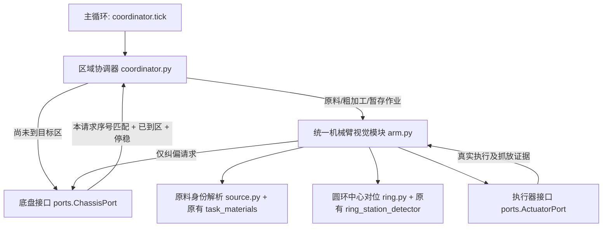

# 视觉抓取放置模块与区域任务切换

## 交付范围

用户于2026-11-12明确：目前负责视觉抓取/放置；先把代码准备好，底盘由队友整合。高层流程不得继续堆入main，行驶与到区作业按状态切换，普通调参不因越过旧工程试值而锁故障。本次落实为香橙派Python模块，F407保留现有底层执行器，由接口调用；不替队友重写底盘算法，不直接把Python流程搬进STM32 main。

电池耗尽后没有连接硬件、烧录或发动作。当前实际板载仍为此前a93760f0定位调试版；新模块未安装到实车执行链。离线模块/仿真通过不等于第二段三件、第三段落环或码垛已实测通过。

## 模块关系



| 文件 | 职责 |
|---|---|
| src/smart_carrier/vision_manipulation/arm.py | 原料逐件抓取装车、车载盘取料、圆环放置、按原顺序回收、暂存/第二层码垛共用状态与库存 |
| coordinator.py | 行驶与到区作业切换；拒绝旧到站回执；STOP两端分别确认 |
| ports.py | 底盘行驶/纠偏/保持/停止、执行器开始/反馈/停止的注册接口；没有默认成功实现 |
| source.py | 调用现有infer_three_identities；三真实实例、两色确认后推唯一余色；普通歧义返回等待 |
| ring.py | 包装现有圆环检测器，用当前画面中心对齐当前中环；不套用原作者参考像素/毫米矩阵 |
| geometry.py | 已经本机MATLAB核对的接触平面→轴心→4310角度/伸缩数学，不接受顶面质心冒充底心 |
| alignment.py | 按底盘接口能力只规划一个纠偏小步，大于20mm等旧试值时分步，动作后要求新观测 |
| task_plan.py | 复用现有四段任务码解析及第二批同色码垛映射；生成区域作业，不写死颜色顺序 |
| parameters.py + config/vision_manipulation_20261112.json | 统一调参及待示教提示，不把缺数据记成整车硬故障 |
| workbench.py / __main__.py | 薄入口：打印计划、显式离线模拟或VNC区域预览；默认不开任何硬件 |

旧main、冻结pzq和队友底盘源码未被本次模块改写。新模块的停止服务要求回执，未使用无条件喂狗、清CAN故障或写假健康。

## 已实现作业

1. 原料区：观察→请求底盘纠偏/保持→按任务顺序等待真实新目标→调用已有pzq单件抓放接口→确认来源已空/曾抓牢/已释放/载槽占用→回180°/65mm观察下一件。原source118800/车载放料7200虚拟脉冲保留为原生动作参数，不伪换成mm。
2. 粗加工：180°/伸缩0mm/开210°观察中环→中环对画面中心并核方向→槽盘0/120/240选择→顶部转取料位→按示教深度下降→140°夹紧→确认抓起→回顶→转目标点顶部→按示教深度下降→开210°→回升、按真实回升50%预收160°→确认物料直立/位置/颜色和释放，再下一件。
3. 回收：用本轮实际放置顺序及位置记录，沿用同一取放结构，仅换圆环回收深度、车载放回深度及目标点；原槽空确认后才扣库存。
4. 暂存：复用放置模块，使用独立区域参数；第二批位置按第一批同色位置关联，下降量为第一层下降量减60mm。如果减后为负，提示当前顶部/高度不支持，不发负下降命令。
5. 看护人工装盘：保留0/120/240及2秒间隔的独立动作请求，已存在库存须先人工整理确认；完成时间不能替代三个槽真实装入及手已撤离。该模式只允许supervised作业，正式无人干预模式拒绝插入人工装盘。

本轮任务215+213+512+321来自用户指定，不冒充扫码。第一批黄红黑→位置213；第二批黑红黄→粗加工321，暂存同色位置312。颜色、实例、槽号、场地位置始终分开。

## main只保留模块调用

```python
from smart_carrier.vision_manipulation import ArmVisionModule, ZoneCoordinator, load_parameters

parameters = load_parameters("config/vision_manipulation_20261112.json")
arm = ArmVisionModule(parameters)
controller = ZoneCoordinator(arm, chassis_port, actuator_port)

# 某段开始时调用一次；底盘模块自己负责路线/速度/位移控制。
controller.request_job(job, navigation_goal, now_ms)

# 原有任务循环里调用，不在这里写机械臂流程。
controller.tick(now_ms)
```

chassis_port/actuator_port必须注册真实函数。没有默认假实现，也没有默认启动电机的入口。

状态：TRAVEL时不调用机械臂；只有同context、zone、command_sequence的已到区且停稳回执才能进入WORK；到区纠偏仅委托底盘align接口，不同时启动普通行驶。WAIT_PARAMETER/WAIT_VISION/WAIT_EVIDENCE不清真实故障；STOPPING必须等底盘和机构各自确认停止才能变STOPPED。仅ACCEPTED、PWM写入、机械DONE均不能代替物理抓牢或放稳。

## 接队友/F407的接口契约

| 接口/动作 | 实现方应接入什么 | 不能做什么 |
|---|---|---|
| ChassisPort.travel_begin/poll | 队友路线模块；goal含command_sequence，Arrival必须回显序号、区域、到达及停稳 | 不用旧到站状态、画面进入区域或命令ACK造到达 |
| ChassisPort.align_begin/poll/hold | 当前实际视觉误差及已核车体系；原底盘控制器和位置保持 | 不因route3未验阻挡区域纠偏，不写假guard/已对准 |
| ActuatorPort.begin/poll | 唯一CAN任务/执行器模块，逐序号接纳Action | 不在main/图像线程里裸发CAN/PWM |
| source_pick_load | 原已验证pzq单件动作；保留原并行时序及50ms松爪等待 | 不把本模块串行动作表重新代替原pzq提速实现 |
| index_carrier | 现有CarrierPwm/槽盘模块，按目标槽分度 | 不把颜色编码当槽号，不跨270°端点当360°循环 |
| move_pose | 4310/伸缩/升降模块；本区域mm下降量经有效标定转原生指令 | 不用原料区旧脉冲直接作为新区域高度 |
| grip | 原夹爪模块，210/140/160来自统一参数 | 不在VNC绘图函数里直接改TIM比较值 |
| verify_held/verify_placed/verify_base | 真实视觉、传感器或明确看护确认，返回对应实例/位置结果 | 不用固定延时、软件DONE或默认True提交库存 |
| stop/stop_poll | 原故障停止服务及真实回执/不活动状态 | 不把重试耗尽当ACK，不清故障伪恢复 |

适配器接纳前检查实际能力。普通参数不适配返回PARAMETER_REJECTED而非真实执行FAILED，模块等待改参数，不锁硬件故障；真实执行失败仍停止。动态目标若声明停盘截止时间，必须有实测抓起/退出预算；预算未测只等待该参数，静止看护调试不冒充动态转停通过。

目前尚未把上述Action协议绑定到现板a93760f0的执行回报，也没有把新模块嵌入队友主任务。此接口集成和实车反馈接入是明确剩余项，不能把端口定义写成已上板。现板临时IT接口仍有旧的精确参数准入，不能宣称本次JSON已全局改掉其门限；正式驱动接入时应移除这些重复工程试值锁，保留实际能力检查。

## 调参位置与放宽方式

统一编辑config/vision_manipulation_20261112.json：

- tuning：4310速度、伸缩/升降速度及加速度、210/140/160、半程比例、50ms等待、60mm叠放高度、2秒装盘间隔、观测时效、动作超时、像素/mm/角度容差、推荐小步值。
- carrier：槽盘固定取料/放回姿态及各自从顶部下降mm。
- zones.rough.positions：中环2号默认180°/0mm；下降量为null。左右1/3为null，待用户手动示教角度、伸缩及下降量。
- zones.storage：单独示教本区点位/高度；复用同一代码，不默认等于粗加工区。
- physical_limits：真实行程/执行器能力，不是工程推荐上限。旋转360为机械规划范围，现板临时逻辑角窗口仍须执行器适配；伸缩170沿用用户已给实测行程，升降mm行程由有效标定/驱动接口提供。

正常正有限速度不再要求等于106/1846.4等旧试验值。65mm纠偏碰到20mm接口能力时规划为小步而非报整车故障，每一步后重新观测。短暂反馈缺失只保持当前命令，不重复执行；普通视觉歧义等待新图。实际越程目标不下发，提示改参数或更新已实测能力；真实失控、执行失败及持续未知运动状态保留STOP。

参数在新作业/本件动作生成前应用。正在执行或已缓存的本件动作不热改位姿。源目标若被执行器以参数拒绝，更新参数后会重新取新目标，不复用过期停盘窗口。对已经生成的圆环动作序列，应先结束/停止该段，再依据实际库存重建，不通过改参数清故障。

## 离线与VNC运行

交付包解压后，start.py是真实文件入口，避免之前python标准输入与相机spawn冲突。

```bash
# 默认只打印任务/区域计划，不打开相机/串口/执行器。
python3 start.py --task-code 215+213+512+321

# 只有明确simulate才使用合成示教和模拟回执，不写用户参数。
python3 start.py --simulate --task-code 215+213+512+321

# 原料区/粗加工区/暂存区实时视觉预览，均不注册执行器。
python3 start.py --preview --zone source
python3 start.py --preview --zone rough
python3 start.py --preview --zone storage
```

预览复用/home/orangepi/p2-source-observer-20261106/vision_app，不覆盖其HSV、ROI或相机配置。窗口显示人工指定任务码、当前区域和识别/中环误差，Q保存退出，默认120秒。此模式不发电机命令；真正区域阶段/成功次数可由controller.status接显示层，不能用预览误标实车已完成。当前粗加工/暂存没有实物新图及已核像素到车体矩阵，先显示像素；本区矩阵未配置时不生成毫米控制量。

## 验证与明天仍需完成

本机MATLAB前置validate_vision_module_flow_20261112覆盖任务/同色关联、60mm高度关系、半程预收、动作顺序、区域交接和小步拆分。Python标准库unittest检查实际模块的来源身份、库存/证据、任务切换、晚/旧回执、参数等待、真实故障STOP及六色余项约束；显式合成回放完成两批十项区域作业。仿真示教值不写生产配置，不把合成反馈记为实物通过。

明天：电池充足后先核当前板与真实参考，实际跑通定位和黄红黑单件/三件；随后粗加工中心单件，用户给取槽/放环下降量，再示教左右点位、回收高度，验证暂存和60mm码垛。执行器回报/视觉实例与当前姿态绑定、动态转停窗口及主状态机接口仍需联调。最后再按用户要求做一次1/2/3段衔接，人工装盘与真实自动验收分别记录。

## 需求与同步

R核QR-01/05/06/07、SRC-01/02、VIS-01、DSP-01、SCORE-01、RUN-01/02/04、FIELD-06、PWR-01、MECH-01/02；E核QR-02/03、VIS-04/07/12/15、CAL-02/03/05、RUN-06、MECH-06。所有调参、模块接口、2秒及60mm用户输入为E，不改官方R；官方Q保持待技术答疑确认。

用户确认本轮复位原因是电池没电，属于现场报告，不伪造电压读数。最后硬件镜像仍a93760f0；本轮离线模块未下载、未改变健康状态或触碰硬件。根Git无提交/remote，隔离fetch核到21522db，保留AGENTS及其他未跟踪成果；仅本地，未提交推送。
